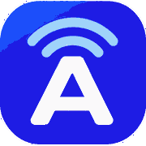

#  AllMy Remote

A lightweight, self-hosted remote desktop and device management platform, built from scratch. One platform. All your devices.

**Status: Sprint 2C — native Windows agent GUI preview.** The shared login/dashboard header uses the approved multi-device logo with separate transparent light and dark variants. The matching app icon is served locally as a browser favicon and Apple touch icon.  The Go core includes an embedded React/TypeScript dashboard, health/readiness, SQLite WAL storage and single-operator authentication API. Adds a mock-only device registry, one-time enrollment and authenticated WebSocket heartbeat. Includes browser sign-in/out, device cards, enrollment grants, revoke action and persistent system/light/dark theme. Includes a loopback-only persistent Compose preview. A Windows x64 native GUI and optional console agent are included for authorized development testing; remote access and production deployment are not available. Features below remain planned.

## Goals

- Browser-based remote desktop for authorized devices, with keyboard, mouse, and multi-monitor support.
- Session-independent universal clipboard across enrolled devices, with explicit enrollment and per-device controls.
- File management, terminal, telemetry, and signed agent updates in later milestones.
- Responsive dashboard with light, dark, and system themes.
- Low idle CPU, memory, and network usage; no screen capture when a session is inactive.
- Self-hosted deployment using a single application and a configurable domain.

## Platform roadmap

| Platform | Target | Status |
| --- | --- | --- |
| Windows 11 x64 | First native host and web client | Presence-only agent preview |
| Linux x64 (Zorin OS) | Native host and web client | Planned |
| Linux ARMv6 | Lightweight management host; GUI conditional | Planned |
| iOS Safari | Browser client; explicit clipboard actions | Planned |
| Managed corporate devices | Only with organizational authorization | Out of initial scope |

## Architecture

Baseline stack: Go server and agents, React/TypeScript web client, SQLite WAL. Native operating system APIs and maintained protocol/codec libraries are allowed; existing remote desktop applications are not used as the project foundation.

See [architecture](docs/architecture.md), [technical specification](docs/specification.md), [threat model](docs/threat-model.md), [acceptance criteria](docs/acceptance.md), [UI guidelines](docs/ui.md), [security](SECURITY.md), and [roadmap](docs/roadmap.md).

## Installation

Local development only; do not expose this preview to the Internet. Production MFA and additional security gates are pending.

With Go 1.26.11 and Node 24.22.3:

```sh
cd web
npm ci --ignore-scripts
npm run typecheck
npm run build
cd ..
go run ./cmd/server
```

Open http://localhost:8080. Status endpoints: /health and /ready. Run `go test -race ./...` for scoped checks.

Container preview (loopback host binding only):

```sh
docker build -t allmy-remote:dev .
docker run --rm --read-only --tmpfs /data:rw,noexec,nosuid,size=16m,uid=65532,gid=65532,mode=0700 --cap-drop ALL --security-opt no-new-privileges -p 127.0.0.1:8080:8080 allmy-remote:dev
```

The non-loopback container listener is explicitly enabled inside the image; never publish its port on a public interface. The React/TypeScript dashboard is built once and embedded into the Go executable. Node is build-time only; no separate frontend runtime is required. SQLite uses a CGO-free driver and Argon2id uses a maintained Go library. The container example uses ephemeral data; persistent storage uses a named volume at /data with a private /data/state child directory owned by UID 65532. Existing experimental data at the volume root requires a separately reviewed migration.

For a persistent, isolated Linux development deployment, follow [the preview deployment guide](docs/deployment-preview.md). The Compose profile binds only to loopback, uses its own named volume and never enables remote access. Manual deployment acceptance is required.

### Operator authentication API

Initialize the single administrator before starting the service with `go run ./cmd/server init-admin`; supply a password (12–256 bytes) via protected standard input, never in command arguments or shell history. For local testing, use the default origin `http://localhost:8080`. The server requires an exact Origin header on login/logout and issues a Secure, HttpOnly, SameSite=Strict cookie. Use HTTPS or a localhost client supporting secure cookies. Endpoints: POST /api/v1/session/login (JSON username and password), GET /api/v1/session, POST /api/v1/session/logout. The username is admin; no default password. Each successful login revokes the previous session; sessions expire after 12 hours. The dashboard uses the same API. No session token is stored in local storage; only the appearance preference is persisted.

### Device registry preview

Authenticated operator endpoints: GET /api/v1/devices, POST /api/v1/enrollment/grants (JSON name), POST /api/v1/devices/{id}/revoke. Grants expire after five minutes and may be exchanged once via POST /api/v1/enrollment/exchange (JSON grant). The exchange returns a device ID, declared platform (mock by default, or windows) and unique credential once; only credential hashes are stored. Native/mock clients use GET /api/v1/device/channel with an Authorization Bearer header, then version-1 JSON hello and heartbeat messages with IDs. Heartbeat interval is 15 seconds, offline timeout 45 seconds. Mock devices and self-reported Windows agents are distinguished in the registry; no remote-control capability is granted. The preview is local only; production TLS, protected credential storage, user consent in the native agent, and remaining security gates are mandatory before remote access.

### Dashboard preview

The dashboard lists real registry data, distinguishes mock and Windows devices, refreshes while visible and never invents telemetry. Generate a one-time grant, transfer it only to an authorized native agent or mock client, refresh the registry, and revoke a device when needed. A revoked device may be permanently deleted after explicit confirmation; active and offline authorized devices cannot be deleted. Deletion frees a registry slot without restoring its old credential. Edit an authorized device to change its display name and select a built-in icon (Automatic, Desktop, Laptop, MacBook, Mac desktop, Windows, Linux, Mini PC, Server, Raspberry Pi, Phone or Tablet). These are server-persisted presentation preferences, independent of device platform, connection and identity; no re-enrollment needed. Schema 4 adds the icon preference with automatic default. Native remote desktop, files, terminal and clipboard remain disabled. Chromium and WebKit browser acceptance run against the compiled binary in CI using an ephemeral loopback HTTPS test proxy. A disposable Compose fixture checks persistent state after container replacement. These do not replace real-device or real-server acceptance. The AllMy Theme Controls switch and Auto button reuse the React component and CSS from the existing AllMy project implementation; the adapter is tailored to this app without Ant Design. The canonical preference key is allmy-theme.

### Windows agent preview

Download the Windows x64 preview artifact from a successful CI run for the reviewed commit, or build locally with Go on Windows: `go build -o allmy-agent.exe ./cmd/agent`. The binary is unsigned; verify its origin and do not disable Windows security controls. Start an interactive terminal under your own Windows account. Create a named device grant in the dashboard, then run `allmy-agent.exe pair --server https://remote.example.com` and enter the grant into the hidden console prompt. The console agent does not start automatically. Run `allmy-agent.exe run` for presence and heartbeat; Ctrl+C stops it. Revoke in the dashboard, then run `allmy-agent.exe unpair` to delete local enrollment. Credentials are encrypted with current-user Windows DPAPI under LocalAppData; no credential in arguments, URLs or logs. TLS certificate checks remain enabled; redirects are rejected. A network access policy that blocks the agent will require a separately authorized access solution; never bypass the policy. No installer, service, privilege elevation, screen capture, input, remote commands, clipboard, hardware telemetry or file access. Windows platform is a client declaration, not attestation. Manual GUI and tray acceptance is pending.

## License

MIT (see [LICENSE](LICENSE)). Third-party dependencies will be reviewed for compatibility and documented before distribution.


### Windows graphical agent

The CI artifact includes the standalone graphical `allmy-remote.exe` and the optional existing console `allmy-agent.exe`. They share the same current-user DPAPI enrollment and exclusive lock; stop the console agent before opening the GUI. The native Win32 GUI has no embedded browser and uses the approved embedded app icon. Double-click the GUI to show its window and connect an already paired device, or enter the HTTPS server and a hidden one-time grant to pair. Connect and Disconnect control presence; closing or minimizing the window hides it to the notification area if the tray is available. Click the tray icon to restore the window or right-click for Open, Connect, Disconnect and Exit. Exit cancels the connection and terminates the application. Unpair removes local enrollment and disables startup; separately revoke in the dashboard.

Start with Windows is opt-in, off by default, and registers only the current user's Run value. No service, elevation, scheduled task or pre-login execution. Keep the GUI executable in a permanent user-owned location before enabling startup; disable and re-enable if relocating it. Windows or organization policy may prevent startup; do not override policy. Existing CLI commands remain available. The icon resource is generated reproducibly from the existing PNG before compiling on Windows: `python tools/windows_icon.py`, then `go build -o allmy-agent.exe ./cmd/agent` or `go build -ldflags="-H=windowsgui -X main.guiBuild=1" -o allmy-remote.exe ./cmd/agent`. Both binaries are unsigned previews. Native GUI and tray behavior require manual Windows acceptance.
